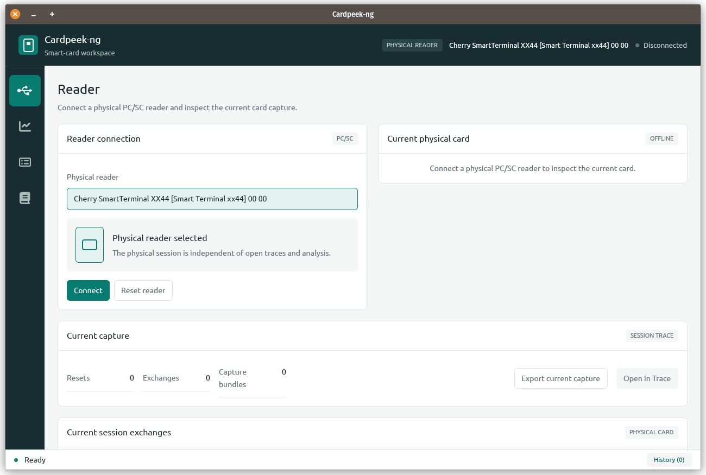
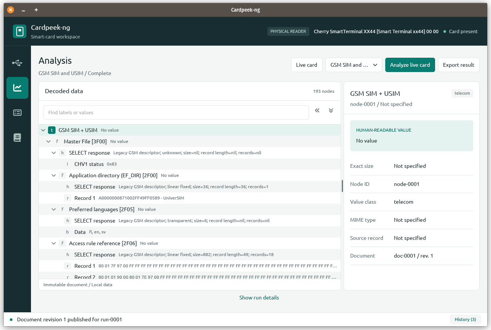
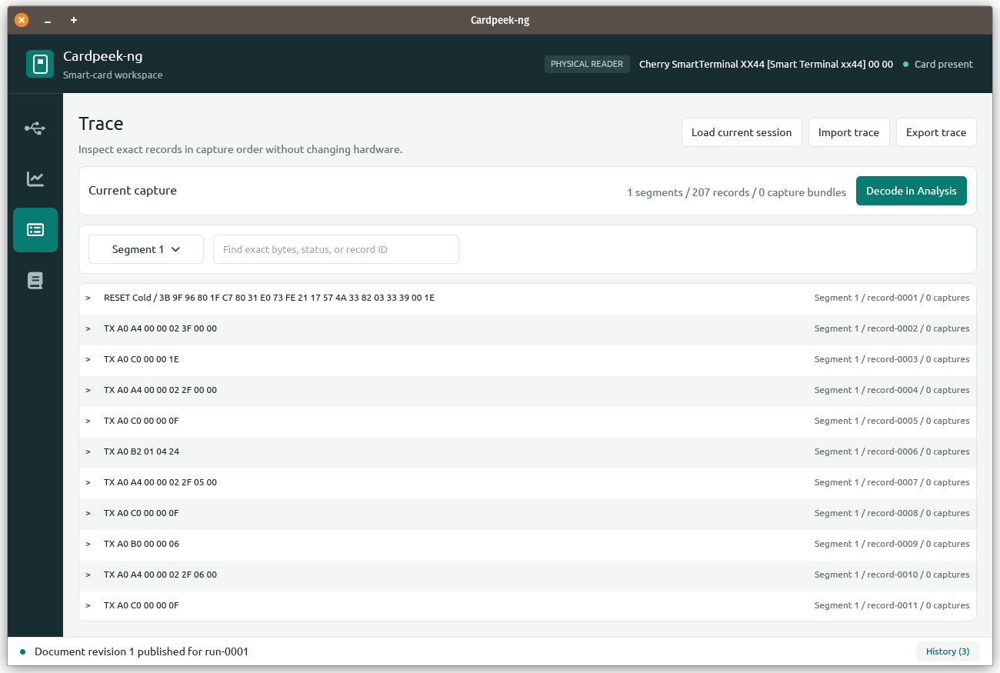
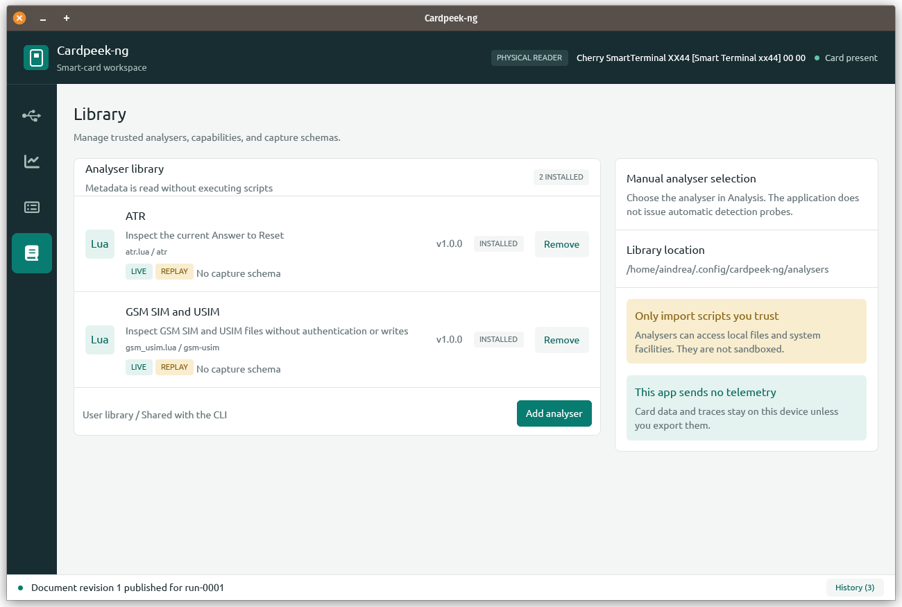

# Cardpeek-ng

Cardpeek-ng reads and analyses smart cards through PC/SC readers.
It includes a desktop application and a command-line interface.
Lua analysers decode card data into a searchable result document.
You can inspect APDU exchanges, save them as JSON traces, and replay those traces without a card or reader.

Cardpeek-ng is inspired by [Cardpeek](https://github.com/l1l1/cardpeek), but uses its own analysers and file formats.
It does not read Cardpeek Lua analysers, XML documents, or trace captures.

## Screenshots

### Reader

Connect to a PC/SC reader and inspect the current card capture.



### Analysis

Run an analyser and explore the decoded result document.



### Trace

Inspect, search, and filter APDU exchanges in capture order.



### Library

Manage the Lua analysers shared by the desktop application and CLI.



## Install the prerequisites

Install Rust 1.100 or newer and the PC/SC development files.

On Debian or Ubuntu, install the reader service and the packages needed to build both applications:

```sh
sudo apt install pcscd libpcsclite-dev pkg-config libgtk-3-dev
```

Windows uses the built-in Smart Card service.
macOS uses the built-in PCSC framework.

The commands below run from the repository root.

## Use the desktop application

Start the application:

```sh
cargo run -p cardpeek-desktop
```

The application has four workspaces:

- **Reader** selects a PC/SC reader, connects to a card, sends APDUs, and exports captures.
- **Analysis** runs an analyser against the connected card or a segment of an open trace.
  It shows progress, logs, APDU exchanges, and decoded results.
- **Trace** opens a JSON trace and lets you inspect, search, filter, and export its exchanges.
- **Library** imports and removes Lua analysers.

To open a trace at startup:

```sh
cargo run -p cardpeek-desktop -- tests/fixtures/traces/atr-synthetic-001.json
```

Opening a trace does not run an analyser.
Select a reset-delimited segment in Analysis to decode or replay it.

## CLI

### Try it without a card

Replay the included synthetic ATR trace:

```sh
cargo run -p cardpeek-cli -- replay \
  tests/fixtures/traces/atr-synthetic-001.json \
  atr \
  --output /tmp/atr-result.json
```

This writes the decoded result to `/tmp/atr-result.json`.
The expected result is in [`tests/fixtures/documents/atr-synthetic-001.json`](tests/fixtures/documents/atr-synthetic-001.json).

The first run creates a personal analyser library and copies the bundled analysers into it.
No card reader is needed for replay.

### Use a real card

If you're new to smart cards, use a disposable test card first.
Do not start with a card that contains credentials or personal data.
Only send APDUs whose effects you understand.

List the connected readers:

```sh
cargo run -p cardpeek-cli -- readers
```

Copy the exact reader name from the output, then run the ATR analyser:

```sh
cargo run -p cardpeek-cli -- run \
  "Exact reader name" \
  atr \
  --output /tmp/atr-result.json \
  --trace-output /tmp/atr-trace.json
```

To send one APDU and record the exchange:

```sh
cargo run -p cardpeek-cli -- transmit \
  "Exact reader name" \
  00A40000023F00 \
  --trace-output /tmp/apdu-trace.json
```

Trace exports are raw by default.
Use `--trace-mode sanitised` to redact ATR values, command data, and response data:

```sh
cargo run -p cardpeek-cli -- run \
  "Exact reader name" \
  atr \
  --output /tmp/atr-result.json \
  --trace-output /tmp/atr-trace.json \
  --trace-mode sanitised
```

Raw traces contain card data and APDU exchanges.
Treat them as sensitive files.
Review sanitised traces before sharing them; redaction does not remove every possible card-specific value.

### Manage analysers

See [Write analyser scripts](docs/analysers.md) for the Lua API, examples, testing, and installation instructions.

List the installed analysers and the library location:

```sh
cargo run -p cardpeek-cli -- analysers list
```

Import every Lua analyser directly inside a directory:

```sh
cargo run -p cardpeek-cli -- analysers import /path/to/analysers
```

Remove an analyser by its identifier:

```sh
cargo run -p cardpeek-cli -- analysers remove atr
```

The desktop and CLI applications share this library.
They do not copy bundled analysers into an existing library again.

Use `--analysers DIRECTORY` with `run` or `replay` to use a different analyser directory without changing the personal library.

Lua analysers are trusted code and are not sandboxed.
Only install and run scripts you trust.

### Build and test

The default tests use synthetic fixtures and do not need a card reader:

```sh
cargo test --workspace
```

Run all local checks with:

```sh
cargo fmt --all -- --check
cargo check --workspace --all-targets
cargo test --workspace
cargo clippy --workspace --all-targets -- -D warnings
cargo doc --workspace --no-deps
```

Hardware tests are separate and require a disposable test card.
See [`docs/hardware-tests.md`](docs/hardware-tests.md).
Developer documentation is in [`docs/architecture`](docs/architecture).

## License

Cardpeek-ng is licensed under GPL-3.0-or-later.
See [`LICENSE`](LICENSE) and [`NOTICE.md`](NOTICE.md).

[](https://github.com/xfoa/Cardpeek-ng/actions/workflows/ci.yml)
