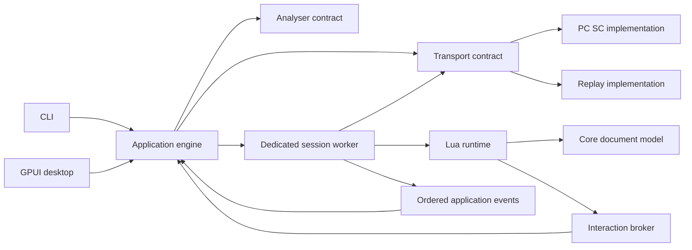

# Overview and architectural rules

## Product scope

Cardpeek-ng will provide:

- A reusable Rust engine.
- A command-line application.
- A GPUI desktop application.
- PC/SC reader access.
- APDU transmission and inspection.
- A Lua API for Cardpeek-ng analysers.
- A UI-independent result document with versioned JSON serialisation.
- Native JSON trace recording and replay.

The first release will not provide:

- USB serial reader support.
- Automatic analyser updates.
- Telemetry.
- An interactive Lua REPL.
- A security sandbox for Lua scripts.
- Compatibility with Cardpeek Lua analysers.
- Compatibility with legacy Cardpeek XML documents and trace captures.

## Approved decisions

- Use a Rust workspace with separate core, transport, runtime, application, and frontend crates.
- Use the pcsc crate for native PC/SC integration.
- Use mlua with vendored Lua 5.4.
- Define a Lua API without Cardpeek compatibility shims.
- Give every analyser run a fresh Lua state and result document.
- Treat Lua scripts as trusted code.
- Use versioned native JSON schemas for documents and traces.
- Use GPL-3.0-or-later for Cardpeek-ng and its bundled analysers.
- Preserve all required third-party notices and attribution.
- Exclude automatic updates and telemetry from the first release.

Verify dependency versions and platform support when implementation starts.
Do not treat research versions as permanent dependency pins.

## Architectural rules

1. Keep UI, Lua, PC/SC, and terminal dependencies outside the core domain types.
2. Give each active card session one owner.
3. Run blocking transport operations outside UI executor threads.
4. Give each active Lua state one owner.
5. Return structured transport errors from native interfaces.
6. Do not convert native transport errors into synthetic card status words.
7. Use stable run-scoped identifiers for result nodes.
8. Use explicit commands and events between the application and its front ends.
9. Use an interaction broker for prompts and file selection.
10. Make replay a first-class transport and test oracle.
11. Treat card data, raw APDU logs, and traces as sensitive by default.
12. Do not execute analyser scripts during analyser discovery.

## Module relationships

